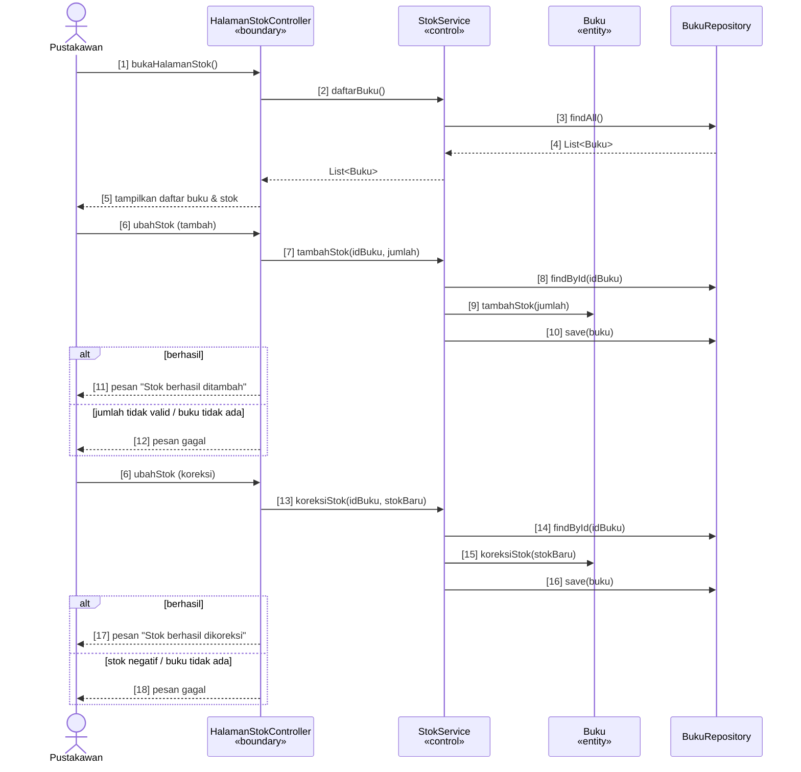
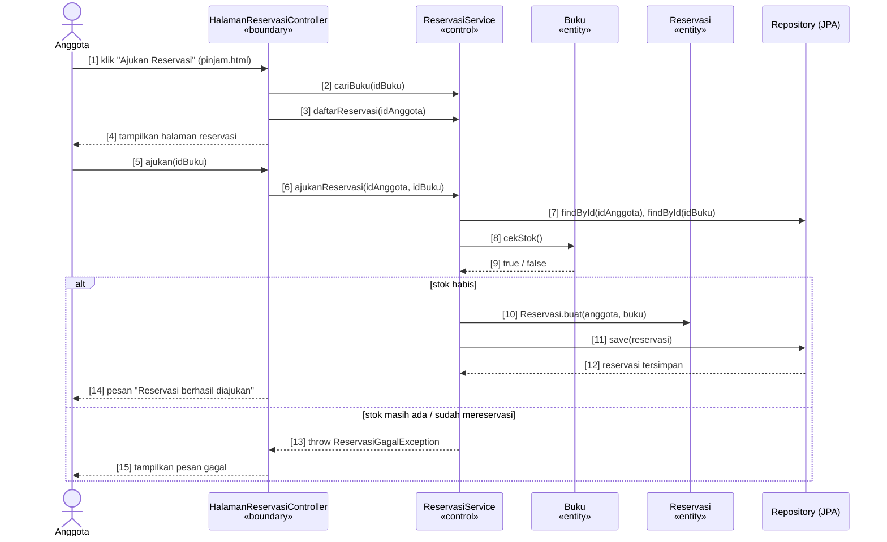

# Sequence Diagram Latihan (pesan diberi nomor)

Nomor `[n]` yang sama ditulis sebagai komentar di kode.
(Tempel blok mermaid ke https://mermaid.live untuk menggambar/ekspor gambar.)

## UC-02 Kelola Stok Buku (aktor: Pustakawan)
Kode: `HalamanStokController`, `StokService`, entity `Buku`

## UC-03 Ajukan Reservasi («extend» Pinjam Buku, aktor: Anggota)
Kode: `HalamanReservasiController`, `ReservasiService`, entity `Reservasi`

